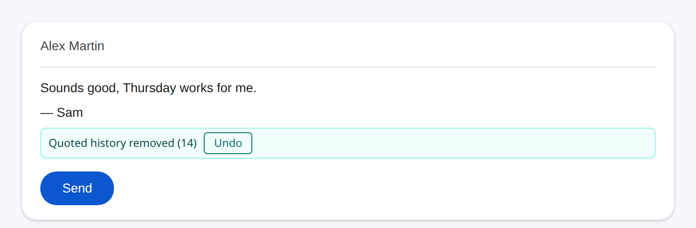
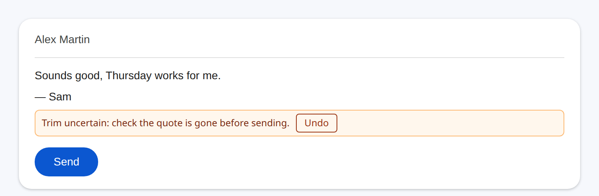
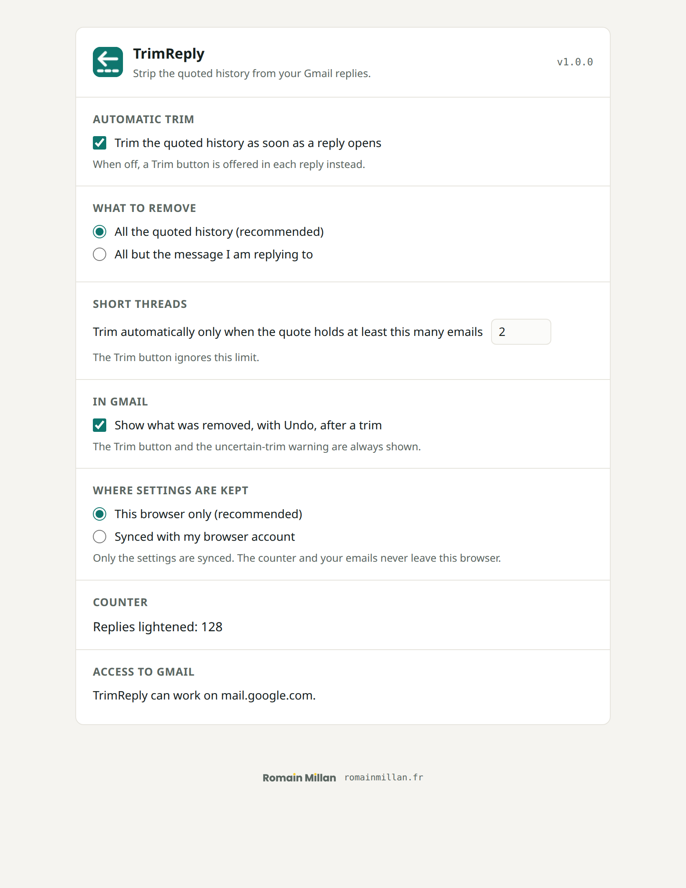

<div align="center">


# TrimReply

**Stop sending the whole conversation.**
TrimReply removes the quoted history from your Gmail replies before you send them.

Chrome · Edge · Brave · Firefox — Manifest V3 — MIT

<sub>Gmail is a trademark of Google LLC. TrimReply is not affiliated with, endorsed by, or produced by Google.</sub>

</div>

---

Every time you reply in Gmail, the whole thread is quoted again underneath. In a long
thread, a one-line answer drags dozens of earlier emails along, and everyone has to
scroll past them. Everybody already has that history in their inbox.

TrimReply removes it as soon as the reply opens. The thread itself stays intact for
everyone: Gmail links messages through their headers (`In-Reply-To`, `References`),
not through the quoted text.



## What it does

- **Trims on its own** when a reply opens — the Reply buttons, the `r` / `a` shortcuts, a
  pop-out window. Prefer to decide each time? Switch auto-trim off and a **Trim** button
  is offered in every reply instead.
- **Undo** puts the quote back, exactly where it was, even after you typed.
- **Keep nothing** (recommended), or **keep only the message you are replying to**.
- **Leaves short threads alone**: by default it only trims when at least 2 emails are
  quoted. The Trim button ignores that limit.
- **Never touches a forward**, a new message, or a draft you reopen.
- **Tells you when it is not sure.** If Gmail could still append the quote on send, the
  bar says so instead of claiming success:



## Private by construction

- Runs entirely in your browser. **No account, no server, no analytics, no network
  request of any kind** — and the repository's tests fail the build if any network call
  appears in the code.
- One permission: `storage`. One site: `mail.google.com`.
- It never reads your inbox: only the reply you are writing, and only its structure.
- The only thing it stores is your settings and a counter of trimmed replies.

TrimReply is a **comfort tool, not a confidentiality control**: Gmail can change without
notice. If the history must not reach someone, check the message before you send it.
Details: [PRIVACY.md](PRIVACY.md) · [SECURITY.md](SECURITY.md).

## Install

1. Download the package for your browser from
   **[Releases](https://github.com/RomainMILLAN/trim-reply/releases)**.
2. Load it — **[INSTALL.md](INSTALL.md)** has the click-by-click for Chrome and Firefox.
3. Open Gmail and reply to a long thread.



## FAQ

**Will the recipient's thread break?** No. Threading relies on the email headers, which
Gmail sets whatever the body contains. This was checked before a line of code was
written ([docs/gmail-spike.md](docs/gmail-spike.md)).

**Why does TrimReply click the `•••` button?** Because a folded quote is not in the
editor at all: Gmail keeps it aside and appends it when you press Send. It has to be
unfolded to be removed.

**It stopped working.** Gmail changes its markup from time to time. Everything TrimReply
knows about it lives in one file, `src/mail/gmail/selectors.js`; please open an issue.
Until it is fixed, TrimReply does nothing rather than something wrong.

**Outlook?** Planned: the adapter boundary is ready (see [ARCHITECTURE.md](ARCHITECTURE.md)).

<details>
<summary><b>Contributing</b></summary>

<br>

Every yarn command runs in a Docker container, never on the host:

```bash
make install          # docker compose + yarn install --frozen-lockfile --ignore-scripts
make test             # node:test, no browser needed
make lint             # addons-linter on the Firefox package
make build            # both packages in web-ext-artifacts/
make lint-workflows   # actionlint + zizmor, as CI does
```

| Folder | What lives there |
|---|---|
| `src/core/` | The domain: settings, decisions, the compose session. No DOM, no browser API. |
| `src/mail/gmail/` | Everything that knows Gmail's DOM. |
| `src/content/` | The content script: the run, the bar, the composition root. |
| `src/ui/`, `src/options.*`, `src/popup.*` | The popup and the options page. |
| `test/` | Unit, adapter, flow and structure tests, on sanitized Gmail fixtures. |
| `docs/` | The Gmail spike, the manual test checklist, release setup, design sources. |

- Fixtures captured from Gmail go through `scripts/sanitize-fixture.mjs`, never raw.
- Screenshots: `docs/design/render.sh` (headless Chrome, mock data only).
- Releasing: `make bump VERSION=x.y.z`, `make tag`, push the tag; see
  [docs/release-setup.md](docs/release-setup.md) first.

</details>

## Licence

MIT — see [LICENSE](LICENSE). Made by [Romain Millan](https://romainmillan.fr/).
